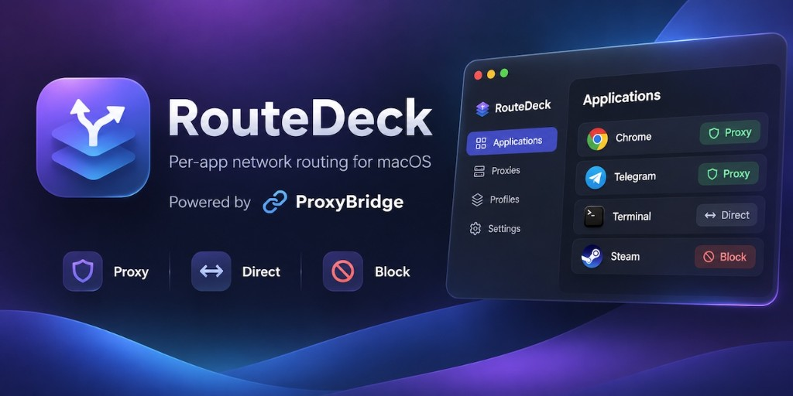

<p align="center">
  
</p>

<p align="center">
  <strong>Per-app network routing for macOS</strong><br>
  Assign <code>Proxy</code>, <code>Direct</code>, or <code>Block</code> per app — powered by
  <a href="https://proxybridge.interceptsuite.com/">ProxyBridge</a>.
</p>

<p align="center">
  <a href="LICENSE"></a>
  
  
  
  
</p>

---

## Why RouteDeck

You already run a VPN client that exposes a local **SOCKS5** or **HTTP CONNECT** endpoint.
RouteDeck lets you decide, app by app, whether traffic goes through that proxy, stays direct, or is blocked — without RouteDeck implementing a VPN itself.

| Policy | Behavior |
| --- | --- |
| **Proxy** | Send matching connections through a chosen SOCKS5 or HTTP CONNECT proxy |
| **Direct** | Leave matching connections alone (explicit choice) |
| **Block** | Block matching connections |

## Features

- **Per-app policies** — route Chrome differently from Terminal, Steam, or helpers
- **Proxy catalog + profiles** — store endpoints once; apply a profile when you need it
- **Honest protection state** — `Active` only when the bridge is ready and coverage is real; never a silent Direct fallback
- **Helper awareness** — discover nested `.app` helpers and review them before apply
- **macOS-native UX** — tray, Dock attention badge, Keychain for passwords (SQLite keeps references only)
- **Activity & health** — bridge status, proxy checks, and RouteDeck events in one place

## How it works

```text
VPN client (local SOCKS5 / HTTP CONNECT)
        │
        ▼
   RouteDeck (policy + profile)
        │
        ▼
 ProxyBridge CLI  ──►  per-process routing on macOS
```

1. Install a VPN client that exposes a local proxy.
2. Install and approve official [ProxyBridge](https://proxybridge.interceptsuite.com/).
3. Add the proxy and pick apps in RouteDeck.
4. RouteDeck builds a profile, validates it, and starts `proxybridge --profile -` with the profile on stdin.
5. The UI shows routing state and health — and refuses to pretend you are protected when you are not.

## Requirements

| Need | Notes |
| --- | --- |
| macOS 13+ | Product target for v1 (desktop only) |
| [ProxyBridge](https://proxybridge.interceptsuite.com/) | Official CLI; system extension approved by you |
| Local SOCKS5 or HTTP CONNECT | From your VPN / proxy client |
| Go 1.26+ | For building from source |
| Node.js + npm | Frontend (`frontend/`) |

## Develop

```bash
# Live reload
wails3 dev

# Production build → bin/RouteDeck.app
wails3 task build

# Go checks
go test ./internal/...
golangci-lint run ./...
```

Stack: **Go** + **Wails v3** + **React / TypeScript / Vite**. Module: `github.com/macrox-pro/route-deck`.

## Documentation

| Doc | Purpose |
| --- | --- |
| [CONCEPTION.md](CONCEPTION.md) | Product bounds, states, non-goals |
| [AGENTS.md](AGENTS.md) | How coding agents must work in this repo |
| [docs/project/STATUS.md](docs/project/STATUS.md) | Current task and phase |
| [docs/contracts/](docs/contracts/) | CLI, Wails, domain contracts |
| [docs/decisions/](docs/decisions/) | Architecture Decision Records |
| [docs/branding/](docs/branding/) | Icon and banner assets |

## Identity

| Item | Value |
| --- | --- |
| Product | MACROX RouteDeck |
| Binary | `route-deck` |
| macOS app | `bin/RouteDeck.app` |
| Bundle ID | `pro.macrox.routedeck` |
| Icon | [docs/branding/route-deck-icon.png](docs/branding/route-deck-icon.png) |

## Important limits

RouteDeck is **not** a VPN and does **not** ship a Network Extension.

- No silent rewrite to `Direct` when a proxy is missing, dead, or unresolved
- No guaranteed kill switch if ProxyBridge crashes
- Platform v1 is **macOS only** — other OS folders in the Wails scaffold are not product scope

## Acknowledgments

RouteDeck stands on excellent open work. Huge thanks to:

| Project | Why it matters here |
| --- | --- |
| [ProxyBridge](https://proxybridge.interceptsuite.com/) by [InterceptSuite](https://interceptsuite.com/) | The macOS process-routing engine RouteDeck drives via the official CLI |
| [Wails](https://wails.io/) by [Lea Anthony](https://github.com/leaanthony) & contributors | Go + web UI desktop runtime that ships RouteDeck as a native macOS app |

If you find RouteDeck useful, consider starring and supporting those projects upstream.

## License

Released under the [MIT License](LICENSE). Copyright © 2026 MACROX TECHNOLOGIES.
